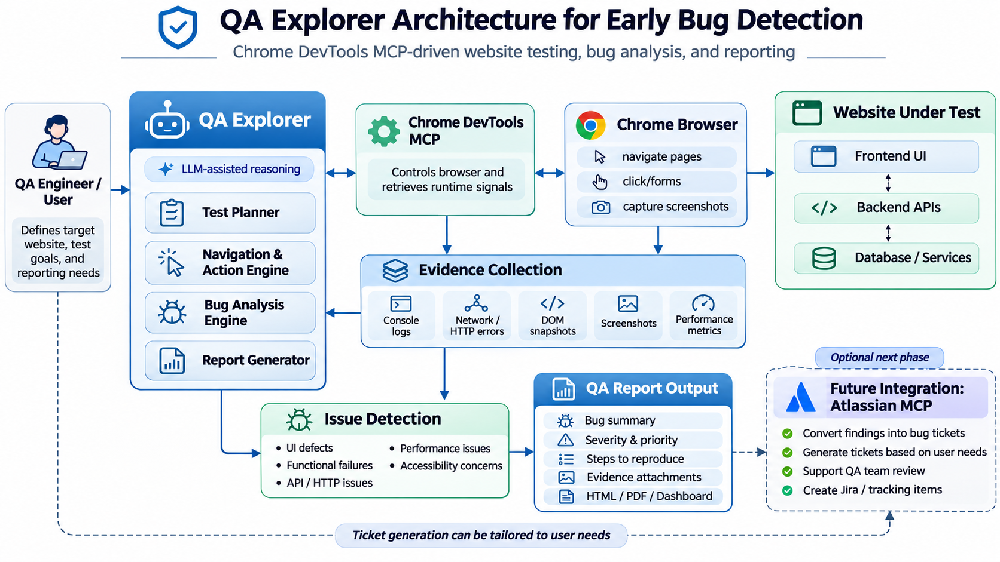

# QA Explorer

QA Explorer is a reusable GitHub Copilot custom agent for browser-based website assessment. Give it a URL, choose a testing depth, provide a safe test account when required, and it uses Chrome DevTools MCP to explore the application, inspect browser signals, confirm defects, capture evidence and generate a professional HTML report.

This repository is intentionally separate from the application repository. QA Explorer should assess the target as a black-box website through its URL rather than reading the application's source code or a private defect checklist.

QA Explorer can:

- Navigate a website through its URL
- Test important user journeys
- Inspect UI, console, network and HTTP behavior
- Identify and reproduce defects
- Capture screenshot evidence
- Generate a professional HTML QA report

QA Explorer performs black-box testing and does not require access to the application source code.

---

# How It Works



| Component | Purpose |
|---|---|
| **GitHub Copilot** | Plans tests, analyses behavior and writes findings. |
| **QA Explorer** | Defines the QA workflow, evidence rules and report format. |
| **Chrome DevTools MCP** | Controls Chrome and collects page, console, network and screenshot evidence. |
| **Atlassian MCP** | Optional future integration for creating selected Jira tickets after review. |

Chrome DevTools MCP is important because it gives the agent access to a real browser. It allows QA Explorer to navigate pages, click controls, complete forms, inspect API and HTTP failures, review console errors and capture screenshots.

---

# Prerequisites

Install or confirm access to:

- Visual Studio Code
- Git
- Node.js and `npx`
- Google Chrome
- GitHub Copilot Chat

Check Node.js:

```powershell
node --version
npx --version
```

---

# 1. Clone the Repository

```powershell
git clone <QA-EXPLORER-REPOSITORY-URL>
cd <QA-EXPLORER-REPOSITORY-FOLDER>
```

---

# 2. Open the Project

```powershell
code .
```

Alternatively, use **File → Open Folder** in Visual Studio Code.

---

# 3. Configure Chrome DevTools MCP

Inside the QA Explorer repository, create this file:

```text
.vscode/mcp.json
```

Add:

```json
{
  "servers": {
    "chrome-devtools": {
      "type": "stdio",
      "command": "npx",
      "args": [
        "-y",
        "chrome-devtools-mcp@latest"
      ]
    }
  }
}
```

Save the file and reload Visual Studio Code.

### Windows fallback

If VS Code cannot start `npx`, change only this line:

```json
"command": "npx.cmd"
```

### Verify the connection

1. Press `Ctrl+Shift+P`.
2. Run **MCP: List Servers**.
3. Confirm `chrome-devtools` is listed and running.
4. Start or restart it if required.

The first run may take slightly longer while `npx` downloads the package. Do not add `--headless`; a visible browser makes the testing process easier to observe.

> Do not place passwords, tokens or API keys in `mcp.json`.

---

# 4. Select the QA Explorer Agent

1. Open GitHub Copilot Chat in VS Code.
2. Open the Agent dropdown.
3. Select **QA Explorer**.

The agent file must be located at:

```text
.github/agents/qa-explorer.agent.md
```

If QA Explorer does not appear, run **Developer: Reload Window**.

---

# 5. Demo Application

Use the deployed Stays.com QA demonstration application:

```text
https://stays-com-hotel-booking-app.vercel.app/
```

Demo credentials:

```text
Email: guest@stays.test
Password: StaysDemo!2026QA
```

The application uses synthetic hotel, booking and payment data. Do not enter real personal or payment information.

---

# 6. Run an Assessment

QA Explorer provides two modes:

| Mode | Typical duration | Purpose |
|---|---:|---|
| **Quick** | 5–8 minutes | Critical smoke paths and a concise report |
| **Extensive** | 20–30 minutes | Broader workflow, validation and diagnostic coverage |

For the first test, select **QA Explorer** and enter:

```text
Assess https://stays-com-hotel-booking-app.vercel.app/ using Quick mode.

Use this synthetic test account:
Email: guest@stays.test
Password: StaysDemo!2026QA

You may create and cancel synthetic test bookings. Do not create Jira tickets. Generate the HTML report and evidence when testing finishes.
```

For wider coverage, replace `Quick` with `Extensive`.

During an evaluation, avoid telling the agent where known defects are located. This allows you to assess what it can discover independently.

---

# 7. Review the Report

QA Explorer generates:

```text
reports/<run-id>/
├── report.html
├── report.json
└── evidence/
```

Open `report.html` to review the generated report.


---

# 8. Optional Jira Ticket Creation

Atlassian MCP is not required for testing or report generation.

You can configure an Atlassian MCP server in VS Code to connect QA Explorer with Jira. After the assessment, it can use the confirmed findings in the report to create Jira tickets when needed.
---

# Project Structure

```text
QA-Explorer-Agent/
├── .github/
│   └── agents/
│       └── qa-explorer.agent.md
├── .vscode/
│   └── mcp.json
├── docs/
│   └── images/
│       └── qa-explorer-architecture.png
├── reports/                  # Created after a run
└── README.md
```

---

# Troubleshooting

- **MCP server missing:** Run **MCP: List Servers**, then start or restart `chrome-devtools`.
- **Chrome does not open:** Confirm `--headless` is not configured.
- **QA Explorer missing:** Check the agent file path and reload VS Code.
- **Login fails:** Recheck the deployed URL and demo credentials.
- **Too few checks:** Use Extensive mode for wider coverage.

---

# Important Notes

- Run QA Explorer only against websites you own or are authorized to test.
- Use dedicated test accounts and synthetic data.
- Quick and Extensive runs are time-boxed assessments, not complete regression testing.
- AI-led exploration may miss defects or misunderstand expected behavior.
- Severity, priority and Jira tickets require human review.

QA Explorer supports professional QA work; it does not replace QA judgment or planned testing.
