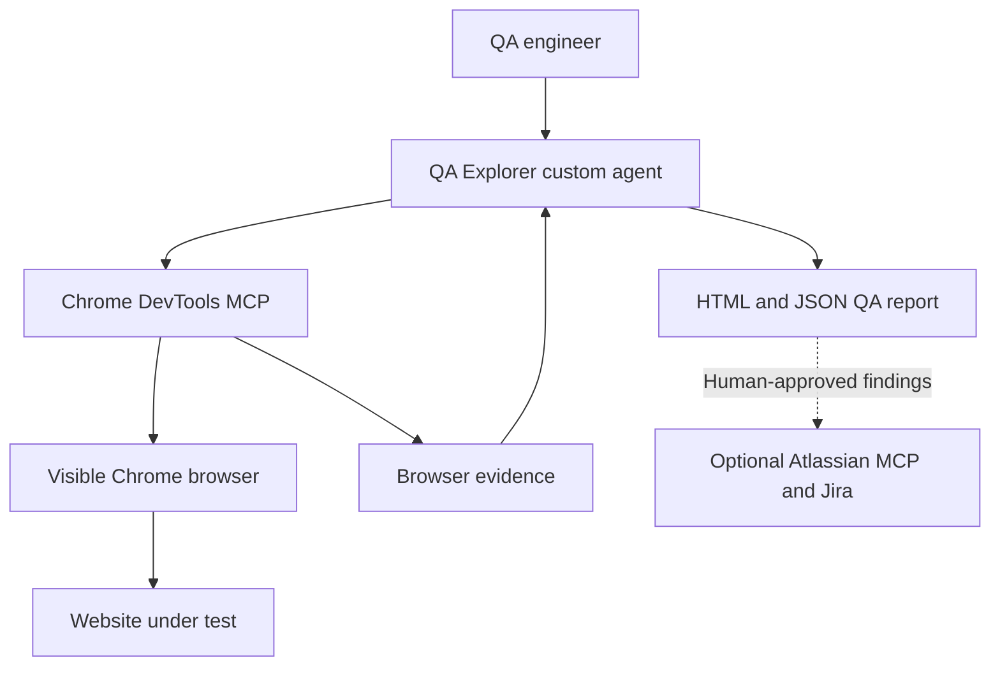

# QA Explorer

QA Explorer is a reusable GitHub Copilot custom agent for browser-based website assessment. Give it a URL, choose a testing depth, provide a safe test account when required, and it uses Chrome DevTools MCP to explore the application, inspect browser signals, confirm defects, capture evidence and generate a professional HTML report.

This repository is intentionally separate from the application repository. QA Explorer should assess the target as a black-box website through its URL rather than reading the application's source code or a private defect checklist.

## Live demonstration application

Use the hosted Stays.com QA demonstration environment:

**Website:** https://stays-com-hotel-booking-app.vercel.app/

**Test account**

```text
Email: guest@stays.test
Password: StaysDemo!2026QA
```

This is a public demonstration account using synthetic hotel, booking and payment data. Do not enter real personal, payment or customer information. The password is intentionally included only for this public test environment and must not be reused elsewhere.

## What QA Explorer does

- Opens the supplied website in a visible Chrome browser.
- Builds a test inventory from the interface it discovers.
- Tests important navigation and primary user journeys.
- Exercises forms, filters, selectors, sorting and validation paths.
- Checks relevant network requests, HTTP failures and console errors.
- Samples desktop, mobile and basic keyboard behavior when the selected mode allows.
- Reproduces suspected defects when safe.
- Captures real PNG screenshots for visible confirmed defects.
- Assigns a bug type, severity, proposed priority and user impact.
- Produces `report.html`, `report.json` and supporting evidence.
- Can optionally create selected Jira tickets through Atlassian MCP after human review.

QA Explorer does not guarantee that every defect will be found. Its output is a time-boxed assessment and should support, not replace, professional QA judgment and planned regression testing.

## How it works



The agent plans and interprets the assessment. Chrome DevTools MCP provides browser control and evidence such as page state, screenshots, console messages and network activity. Jira publication remains optional and requires an explicit user request.

## Required repository structure

After setup, the QA Explorer repository should contain this structure:

```text
QA-Explorer-Agent/
├── .github/
│   └── agents/
│       └── qa-explorer.agent.md
├── .vscode/
│   └── mcp.json
├── reports/                 # Created after a test run
└── README.md
```

The two configuration files have different responsibilities:

| File | Purpose |
|---|---|
| `.github/agents/qa-explorer.agent.md` | Defines QA Explorer's role, test modes, safety rules, evidence requirements and report format. |
| `.vscode/mcp.json` | Tells VS Code how to start the Chrome DevTools MCP server used by the agent. |

VS Code discovers workspace custom agents from `.github/agents`. Keep the `.agent.md` extension and do not rename the file to `.txt`.

Generated results are written under:

```text
reports/<run-id>/
├── report.html
├── report.json
└── evidence/
    ├── screenshots/
    ├── technical/
    └── run-notes.txt
```

## Prerequisites

Each colleague needs:

- Visual Studio Code with GitHub Copilot Chat access.
- A supported version of Chrome.
- Node.js and `npx` available in the terminal.
- Chrome DevTools MCP configured and enabled in VS Code.
- Permission to access the website being assessed.
- Optional Atlassian MCP access only if Jira ticket creation is required.

Check Node and `npx`:

```powershell
node --version
npx --version
```

## 1. Clone and open the QA repository

Use the green **Code** button on the QA Explorer GitHub repository, copy its URL, then run:

```powershell
git clone <QA-EXPLORER-REPOSITORY-URL>
cd <QA-EXPLORER-REPOSITORY-FOLDER>
code .
```

Open the QA repository as its own VS Code workspace. Do not add the Stays.com application repository, evaluator or private defect checklist to the same workspace. This helps preserve a realistic URL-only assessment.

## 2. Configure Chrome DevTools MCP

### Why QA Explorer uses Chrome DevTools MCP

GitHub Copilot provides the reasoning: it decides what to test, compares expected and actual behavior, evaluates impact and writes the report. However, Copilot needs a browser tool to interact with and inspect a real website.

Chrome DevTools MCP provides that browser capability. It allows QA Explorer to:

- Open and navigate the target in Chrome.
- Click buttons, links, tabs and other controls.
- Enter values into forms and complete user journeys.
- Inspect the rendered page and visible application state.
- Review browser console errors and warnings.
- Inspect network requests, HTTP status codes and API failures.
- Capture PNG screenshot evidence for confirmed visible defects.
- Observe basic performance and responsive behavior when included in the test mode.

Without Chrome DevTools MCP, QA Explorer can discuss a test approach but cannot independently perform this browser-based assessment or collect the same browser evidence.

### Create the VS Code MCP configuration

The following setup is recommended because it stays inside the QA Explorer repository and can be shared with colleagues.

1. Open the QA Explorer repository in VS Code.
2. In the repository root, create a folder named `.vscode` if it does not already exist.
3. Inside `.vscode`, create a file named `mcp.json`.
4. Add the following configuration:

```json
{
  "servers": {
    "chrome-devtools": {
      "type": "stdio",
      "command": "npx",
      "args": [
        "-y",
        "chrome-devtools-mcp@latest"
      ]
    }
  }
}
```

The final file path must be:

```text
.vscode/mcp.json
```

### Windows fallback

If VS Code reports that it cannot find or launch `npx`, change only the command from `npx` to `npx.cmd`:

```json
{
  "servers": {
    "chrome-devtools": {
      "type": "stdio",
      "command": "npx.cmd",
      "args": [
        "-y",
        "chrome-devtools-mcp@latest"
      ]
    }
  }
}
```

Use the fallback only when the standard `npx` command does not work.

### What the configuration means

| Setting | Meaning |
|---|---|
| `servers` | Contains the MCP servers available in this VS Code workspace. |
| `chrome-devtools` | The server name displayed by VS Code and Copilot. |
| `type: stdio` | Runs the MCP server as a local command and communicates through standard input/output. |
| `command: npx` | Uses Node.js to start the package without requiring a separate global installation. |
| `-y` | Allows `npx` to use the requested package without an interactive installation confirmation. |
| `chrome-devtools-mcp@latest` | Starts the current Chrome DevTools MCP package. |

### Verify the MCP server

1. Save `.vscode/mcp.json`.
2. Press `Ctrl+Shift+P` in VS Code.
3. Run **MCP: List Servers**.
4. Confirm that `chrome-devtools` appears.
5. Start or restart it if VS Code shows that it is stopped.
6. Open GitHub Copilot Chat and confirm that Chrome DevTools tools are available to the session.

The first run may download the package through `npx`, so it can take slightly longer than later runs. Review any tool-approval request before allowing it; the exact approval behavior depends on VS Code, Copilot and your organization's policy.

It is safe to commit `.vscode/mcp.json` because this configuration contains no passwords or tokens. Never add website credentials, Atlassian credentials, API keys or session tokens to this file.

### Alternative: add the server through VS Code

If your organization does not allow repository-level MCP configuration:

1. Press `Ctrl+Shift+P`.
2. Run **MCP: Add Server**.
3. Choose **Command (stdio)**.
4. Enter `npx -y chrome-devtools-mcp@latest`.
5. Use `chrome-devtools` as the server ID.
6. Choose the destination required by your team's policy.
7. Run **MCP: List Servers** and verify that it is running.

If Chrome DevTools MCP is already connected and working in the current VS Code workspace, do not add a duplicate server.

Do not configure `--headless` for this demonstration. A visible Chrome browser makes the run easier to observe and explain to colleagues.

Official setup references:

- [Chrome DevTools for agents](https://developer.chrome.com/docs/devtools/agents/get-started)
- [Add MCP servers in VS Code](https://code.visualstudio.com/docs/agent-customization/mcp-servers)

## 3. Select QA Explorer

1. Open **GitHub Copilot Chat** in VS Code.
2. Start a new local chat session.
3. Open the agent picker.
4. Select **QA Explorer**.

If QA Explorer does not appear:

- Confirm `.github/agents/qa-explorer.agent.md` exists.
- Confirm the repository root containing `.github` is open in VS Code.
- Run **Developer: Reload Window**.
- Open **Chat: Open Customizations** and check the Agents section.
- Confirm your VS Code and GitHub Copilot extensions are current.

Official custom-agent reference:

- [Custom agents in VS Code](https://code.visualstudio.com/docs/agent-customization/custom-agents)

## 4. Start an assessment

QA Explorer supports two modes.

| Mode | Typical duration | Intended coverage |
|---|---:|---|
| Quick | 5–8 minutes | Critical smoke paths and approximately 8–15 meaningful checks |
| Extensive | 20–30 minutes | Broader systematic coverage and approximately 25–40 meaningful checks |

The check counts are planning guides. The agent must not invent, split or duplicate checks to reach a number.

### Recommended first run

Copy this into QA Explorer:

```text
Assess https://stays-com-hotel-booking-app.vercel.app/ using Quick mode.

Use this dedicated synthetic test account:
Email: guest@stays.test
Password: StaysDemo!2026QA

You may create and cancel your own synthetic test bookings. Do not create Jira tickets. Generate the HTML report and evidence when testing finishes.
```

### Extensive run

Use this when broader coverage and a longer run are acceptable:

```text
Assess https://stays-com-hotel-booking-app.vercel.app/ using Extensive mode.

Use this dedicated synthetic test account:
Email: guest@stays.test
Password: StaysDemo!2026QA

You may create and cancel your own synthetic test bookings. Continue through the planned coverage after finding defects. Do not create Jira tickets. Generate the HTML report and evidence when testing finishes.
```

QA Explorer should confirm the access method and testing permission before opening the target. Once confirmed, it continues autonomously within the selected scope.

## 5. During the run

- A visible external Chrome browser should open or become available to the agent.
- Allow the agent to navigate, fill synthetic forms and inspect browser evidence.
- Tool approval prompts depend on VS Code, Copilot and organization policies.
- Review approval requests before allowing them. Do not disable security controls solely to remove prompts.
- Do not manually guide the agent toward known defects during an evaluation run.
- Do not provide the application repository or a hidden defect list.
- If MFA, SSO or a human verification step appears, complete it manually and tell the agent to continue.

The agent must avoid real payments, real notifications, destructive non-synthetic changes, security bypasses and unrelated-site crawling.

## 6. Review the report

When the run finishes, open:

```text
reports/<run-id>/report.html
```

The report prioritizes confirmed findings and contains:

- Executive verdict and coverage counts.
- Passed, failed, blocked and untested checks.
- Confirmed defect count.
- Bug type and affected workflow.
- Severity and proposed priority.
- User or system impact.
- Expected and actual behavior.
- Reproduction steps.
- Screenshot and relevant technical evidence.
- Possible causes clearly labelled as hypotheses.
- Recommended next action.
- Environment, limitations and untested scope.

`report.json` is the structured source of truth used to generate the HTML report.

### Open the report through a local web server

If browser security prevents local links or screenshots from opening correctly, run this command from the repository root:

```powershell
py -m http.server 5500
```

If `py` is unavailable, use:

```powershell
python -m http.server 5500
```

Then open:

```text
http://127.0.0.1:5500/reports/<run-id>/report.html
```

Press `Ctrl+C` in the terminal to stop the local server.

## 7. Understand the result correctly

- A passed check means only that the recorded scenario passed under the observed conditions.
- A failed check is not automatically a unique defect. Several failed checks can point to one root issue.
- Severity describes impact. Proposed priority describes suggested urgency.
- `Blocked` means the scenario could not proceed because a prerequisite was unavailable.
- `Not tested` means the scenario was identified but not executed.
- A partial assessment must not be presented as complete regression coverage.
- A suspected root cause remains a hypothesis unless supported by sufficient evidence.
- Human review is required before sharing findings or creating tickets.

## 8. Optional Jira ticket creation

Atlassian MCP is not required for testing or report generation.

After reviewing the report, the user may ask QA Explorer to publish selected findings. Example:

```text
Create Jira tickets only for QA-001 and QA-003 in project ABC. Check for duplicates first and return the created ticket URLs.
```

QA Explorer should:

1. Create tickets only when explicitly requested.
2. Publish only the selected confirmed findings.
3. Check for likely duplicates when the available tools support it.
4. Preserve reproduction steps, severity, priority, impact and evidence references.
5. Record only ticket URLs actually returned by Jira.

Never place Atlassian credentials inside the repository.

## 9. Sharing reports safely

Reports and screenshots can contain application data visible during testing.

Before committing or sharing a report:

- Review every screenshot.
- Remove personal, customer, payment, cookie and token information.
- Confirm no password is visible.
- Confirm the target organization allows the evidence to be shared.
- Keep the complete evidence folder beside `report.html` and `report.json`.

To keep generated results local, add this to `.gitignore`:

```gitignore
reports/
```

Ignoring the folder does not delete existing reports or remove files already committed.

## 10. Troubleshooting

### Chrome DevTools MCP is missing

- Run **MCP: List Servers**.
- Start or restart `chrome-devtools`.
- Verify `node --version` and `npx --version` work.
- Check the MCP server output in VS Code.
- Confirm MCP tools are enabled for the current Copilot session.

### Chrome does not open visibly

- Confirm the MCP arguments do not include `--headless`.
- Close stale test-browser processes and restart the MCP server.
- Start a fresh Copilot chat after restarting the server.

### QA Explorer is missing from the agent picker

- Verify the agent path and `.agent.md` extension.
- Reload the VS Code window.
- Ensure the QA repository root is the opened workspace.

### Login fails

- Confirm the target URL is the production URL.
- Confirm the email and password match this README.
- Re-enter the credentials without leading or trailing spaces.
- Report a genuine application rejection as observed behavior rather than silently bypassing authentication.

### Screenshots are not present

- Confirm Chrome DevTools MCP has permission to write inside the repository workspace.
- Confirm the run's `evidence/screenshots` directory exists.
- The agent must capture a real PNG for each visible confirmed defect or disclose why capture failed.

### The report found only a few defects

- Confirm the intended mode was selected.
- Quick mode is intentionally time-boxed.
- Use Extensive mode for broader selector, workflow, validation and diagnostic coverage.
- The agent must report actual observations and cannot guarantee a fixed defect count.

### The report does not open correctly

- Start the local Python web server described above.
- Keep the report and evidence directories together.
- Open the report from `127.0.0.1:5500` rather than moving the HTML file alone.

## Limitations

- AI-led exploration can miss defects or misunderstand expected behavior.
- Coverage depends on the selected mode, available time, access and visible application controls.
- The default workflow samples browser and responsive behavior. It is not full cross-browser certification.
- Basic accessibility observations are not a complete WCAG audit.
- Observed slowness is not a confirmed performance defect without suitable measurement.
- The agent is not authorized to perform penetration testing or bypass security controls.
- External services, rate limits and MCP availability can block parts of a run.
- Severity and priority are proposals that require team review.
- Jira ticket creation is optional and should follow the team's governance process.

## Suggested evaluation approach

When evaluating QA Explorer itself:

1. Give the agent only the public URL, approved credentials and action permissions.
2. Do not reveal the seeded-defect checklist before the run.
3. Allow the agent to finish and preserve its report.
4. Compare the completed report with the private checklist afterward.
5. Measure confirmed-defect precision, meaningful coverage, evidence quality, elapsed time and token usage.
6. Record missed defects separately from false positives.

The private checklist is an evaluation reference, not an instruction set for the agent. Keeping it separate demonstrates how well the agent discovers issues from the website itself.

## Responsible use

Run QA Explorer only against websites you own or are authorized to test. Use dedicated test accounts and synthetic data. Review all evidence and proposed tickets before sharing them with a wider team.

